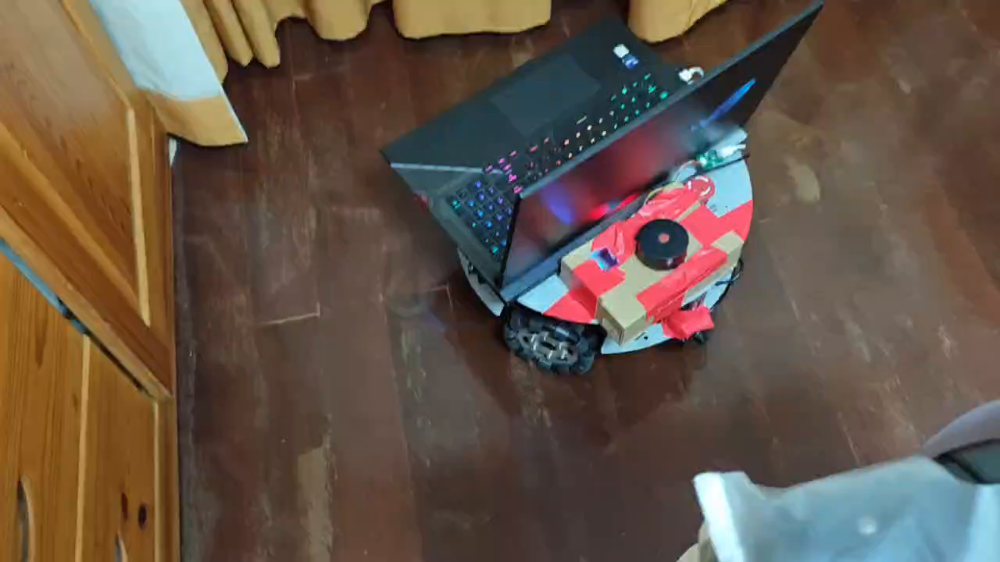
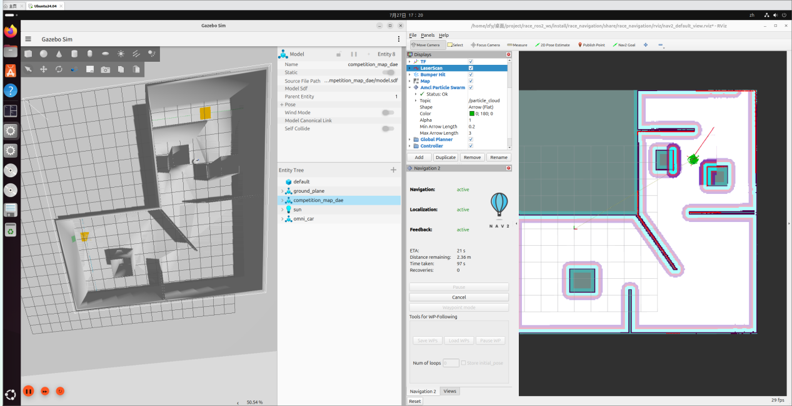
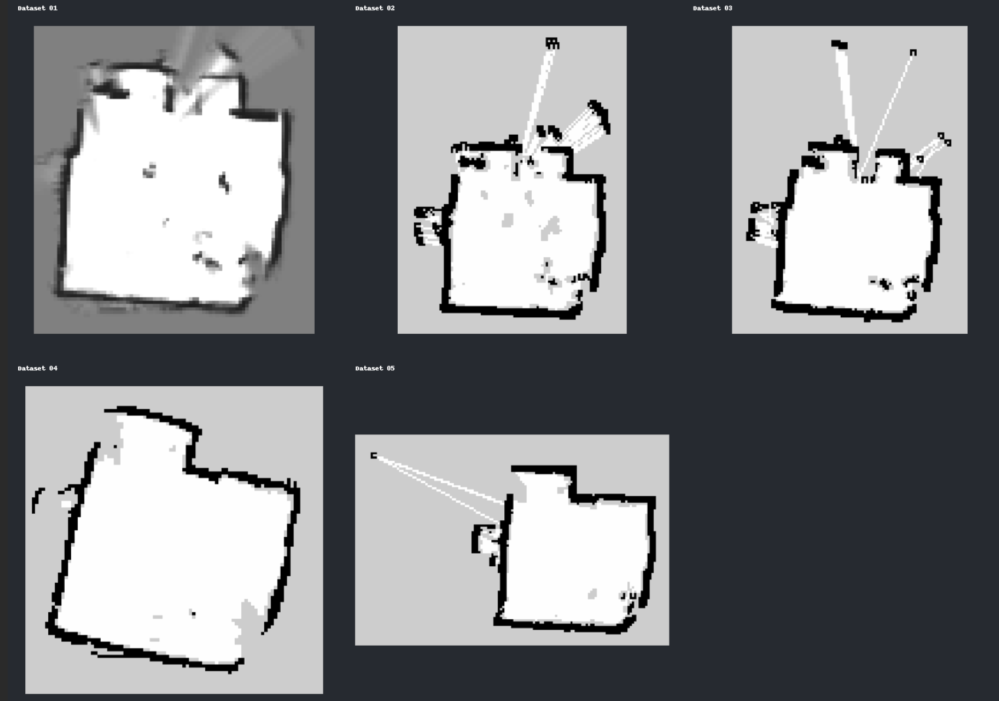
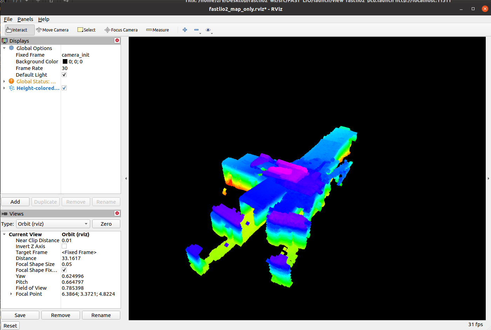

# Fengyuan Zhu

MSc student in Software Engineering and Artificial Intelligence at ITMO University. I work on mobile robot navigation and am interested in perception, mapping and localization in real environments.

## Selected projects

### Physical mobile robot navigation and target approach

A ROS 1 navigation project on a WHEELTEC omnidirectional robot equipped with a 2D LiDAR and a camera. The robot uses Cartographer to build a map, AMCL for localization, and move_base with TEB for navigation. It searches the indoor environment for a green A4 target, aligns with it using the camera, and approaches using LiDAR distance measurements.

- Completed an end-to-end indoor run on the physical robot, from autonomous search to stopping at the target.
- Tested navigation around luggage and furniture. A narrow passage remained challenging: a roughly 39 cm diameter robot could not consistently pass a roughly 60 cm opening without contact, even after costmap tuning.

**Tools:** ROS 1 Noetic · Cartographer · AMCL · move_base · TEB · 2D LiDAR · camera

[Project notes and test record](https://github.com/zfyyyyy/robot/blob/main/race_ws/docs/physical_robot_project_summary.md) *(private repository; access required)*

### Three-wheel omnidirectional navigation in simulation

A competition-style navigation task built with ROS 2 Jazzy and Gazebo Sim 8. The simulated robot maps the environment, localizes on a saved map, navigates among obstacles, searches for a green target and carries out a camera-guided final approach.

- Connected SLAM Toolbox and Nav2 with AMCL, Theta* global planning and MPPI Omni local control.
- Completed the full task in simulation, including autonomous target search and stopping; the workspace also includes a dynamic-obstacle test.

**Tools:** ROS 2 Jazzy · Gazebo Sim 8 · Nav2 · SLAM Toolbox · AMCL · Theta* · MPPI

[Project README](https://github.com/zfyyyyy/robot/tree/main/race_ros2_ws) *(private repository; access required)*

### Mapping experiments in changing and reflective scenes

Compared maps produced with Cartographer and SRRG mapper2d using recordings with and without people, and kept a separate mirror-reflection recording. These experiments made me interested in how moving objects, reflections and mapping errors affect the map used by a robot for localization and navigation.

The recordings and configurations are retained for further analysis; the comparisons do not yet establish a quantitative improvement in dynamic-object removal or localization accuracy.

**Tools:** ROS bags · Cartographer · SRRG mapper2d · 2D LiDAR

### FAST-LIO2 point-cloud mapping experiments

Ran the existing [FAST-LIO2](https://github.com/hku-mars/FAST_LIO) LiDAR–IMU mapping pipeline on recorded R3LIVE/HKU data in ROS Noetic. I tested parameter combinations on a small, geometrically challenging sequence and inspected the resulting trajectories and point-cloud maps for drift, thickened walls and broken structures.

The small-scene pipeline ran, but map quality still needs improvement; a larger building sequence could not be mapped to completion with the available virtual-machine memory. These are reproduction and tuning experiments using an existing algorithm and recorded data.

**Tools:** ROS 1 Noetic · FAST-LIO2 · LiDAR–IMU odometry · RViz · point clouds

[Experiment notes](https://github.com/zfyyyyy/robot/blob/main/fastlio2_ws/PROJECT_SUMMARY.md) *(private repository; access required)*

### Warehouse mapping and navigation in simulation

Built a ROS Noetic and Gazebo learning project with TurtleBot3, gmapping, AMCL and move_base. It covers 2D mapping, navigation on a saved map and multi-waypoint patrol in a warehouse scenario.

[Project README](https://github.com/zfyyyyy/robot/tree/main/week01_mapping_ws) *(private repository; access required)*

## Interests

- Robust mobile robot localization and mapping in difficult indoor environments
- Dynamic objects, reflective surfaces and their effects on maps
- Visual perception, semantic mapping and object-oriented navigation

**Contact:** 2495534260@qq.com

